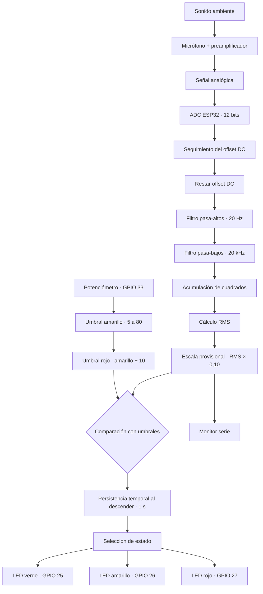
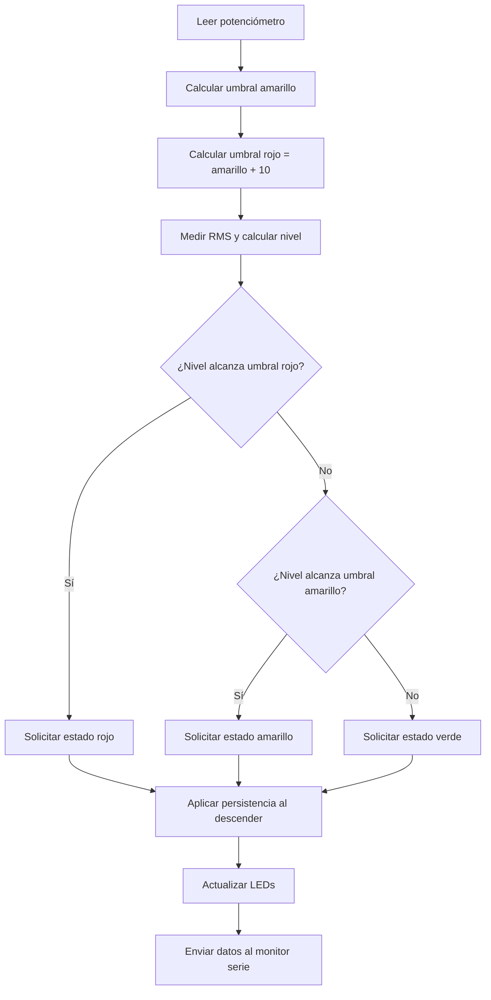

# Medidor de contaminación sonora con ESP32

Indicador visual de nivel sonoro para un aula. El firmware adquiere una señal analógica de micrófono preamplificado, estima el offset de continua, aplica dos filtros digitales biquad, calcula RMS y compara el resultado con umbrales ajustables mediante un potenciómetro. Tres LEDs representan los estados normal, alerta y alerta alta.

> **Importante:** la conversión `nivel = RMS × 0,10` es provisional. No representa dB ni dB(A). Los filtros pasa-altos de 20 Hz y pasa-bajos de 20 kHz no implementan la ponderación A.

## Hardware y pines

| Elemento | GPIO | Función |
|---|---:|---|
| MAX4466 OUT | 32 | Entrada analógica de audio |
| Potenciómetro 10 kΩ | 33 | Ajuste del umbral amarillo |
| LED verde | 25 | Estado normal |
| LED amarillo | 26 | Primer nivel de alerta |
| LED rojo | 27 | Nivel alto |

El sketch original declara `PIN_MIC = 32`. Si el montaje actual tiene `OUT` conectado al GPIO 35, cambiar esa constante a `35`. La salida del preamplificador debe permanecer dentro del rango permitido por el ADC y compartir GND con el ESP32.

## Diagrama de bloques del proceso



## Representación del tratamiento digital de audio

```mermaid
flowchart LR
    A["Muestras ADC x[n]"] --> B["Estimación de offset DC"]
    B --> C["Centrado: x[n] − offset"]
    C --> D["Biquad pasa-altos · 20 Hz"]
    D --> E["Biquad pasa-bajos · 20 kHz"]
    E --> F["Cuadrado y[n]²"]
    F --> G["Promedio de cuadrados"]
    G --> H["Raíz cuadrada"]
    H --> I["RMS del bloque"]
```



El RMS se calcula como:

\[
RMS = \sqrt{\frac{1}{N}\sum_{n=0}^{N-1} y[n]^2}
\]

donde `y[n]` es la muestra después de restar el offset y aplicar ambos filtros.

## Lógica de umbrales e indicadores



### Persistencia de las luces

- Al subir a una categoría superior, el indicador cambia inmediatamente.
- Al bajar de categoría, el estado actual se conserva hasta que transcurra al menos un segundo desde su última activación o cambio hacia una categoría superior.
- Si el nivel continúa alto, la alerta permanece activa.

## Parámetros del firmware

| Parámetro | Valor |
|---|---:|
| Resolución ADC | 12 bits |
| Frecuencia asumida para diseñar los filtros | 48 kHz |
| Pasa-altos | 20 Hz |
| Pasa-bajos | 20 kHz |
| Bloque RMS | 4.800 muestras |
| Umbral amarillo | 5 a 80 |
| Margen del umbral rojo | 10 unidades |
| Persistencia mínima al descender | 1.000 ms |
| Escala provisional | RMS × 0,10 |

## Consideraciones técnicas y limitaciones

1. **Frecuencia de muestreo:** el código diseña los filtros suponiendo `FS = 48.000 Hz`, pero las llamadas consecutivas a `analogRead()` no están temporizadas explícitamente. Por eso, el programa no garantiza una frecuencia real de 48 kHz. Para que los filtros tengan las frecuencias de corte previstas será necesario implementar adquisición temporizada o continua con frecuencia conocida.
2. **Ponderación A:** los filtros de 20 Hz y 20 kHz no equivalen a la curva normalizada dB(A). La ponderación A requiere una red de filtrado específica.
3. **Calibración:** `RMS × 0,10` es una escala interna provisional, no una conversión acústica. Para informar dB(A) se necesita implementar ponderación A y calibrar contra una referencia adecuada.
4. **Umbrales:** los valores 5–80 y el margen de 10 están expresados en la escala provisional, no en dB.
5. **Entrada ADC:** comprobar que la tensión del preamplificador no exceda el rango admitido por el ESP32.

## Estructura del repositorio

```text
medidor-contaminacion-sonora/
├── README.md
└── src/
    └── medidor_contaminacion_sonora.ino
```

## Carga del firmware

1. Abrir `src/medidor_contaminacion_sonora.ino` en Arduino IDE.
2. Seleccionar la placa ESP32.
3. Verificar `PIN_MIC` según el cableado real.
4. Compilar y cargar.
5. Abrir el monitor serie a 115200 baudios.

## Licencia

Agregar una licencia al repositorio si se desea permitir la reutilización y distribución del proyecto.
